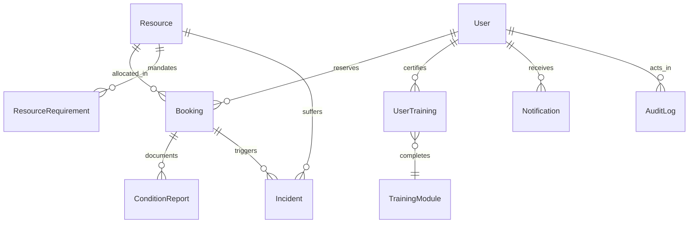
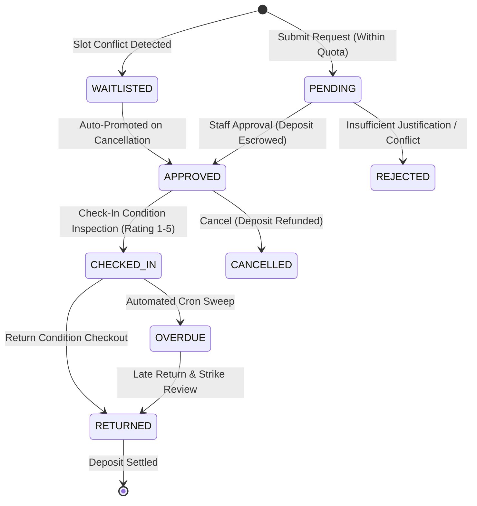

# CampusShare 🎓🏛️
> **Unlock Underused Campus Equipment and Spaces with Fair Allocation, Safety Certifications, and Lifecycle Accountability.**

[](https://nextjs.org/)
[](https://react.dev/)
[](https://www.prisma.io/)
[](https://tailwindcss.com/)
[](https://vitest.dev/)
[](https://www.typescriptlang.org/)

---

## 📌 Executive Summary & Hackathon Scope

University campuses invest hundreds of millions in specialized scientific instruments, fabrication facilities, high-performance computing clusters, and multimedia suites. Yet, up to **60% of specialized equipment sits idle outside peak lab hours**, while researchers and student project teams face multi-week backlogs due to departmental silos, opaque scheduling, lack of safety verification, and zero accountability for damage or delays.

**CampusShare** solves this systemic problem for Northfield University by delivering an end-to-end platform for cross-departmental equipment and facility sharing featuring:

1. **Gatekept Safety & Eligibility Verification**: Automated checking of safety training credentials, department permissions, account standing, and credit deposits before any reservation can be placed.
2. **Anti-Hoarding Fairness Engine**: Priority scoring algorithms (`base 100 - recent usage + waitlist seniority + academic purpose bonus - conduct strikes`) to eliminate equipment hoarding and ensure equitable access.
3. **Double-Checked Condition Lifecycle**: Mandatory, side-by-side condition inspection reports at check-in and check-out with automatic incident drafting if equipment returns damaged or degraded.
4. **Automated Incident Adjudication & Overdue Sweeps**: Background sweep engine detecting overdue sessions, auto-drafting delay incidents, and empowering managers to assess strikes, fines, or suspensions.
5. **Auto-Promoting Priority Waitlist**: Automatic detection of overlapping requests with instant priority-sorted promotion when reservations are cancelled or rejected.
6. **Immutable, Tamper-Evident Audit Ledger**: Append-only audit logs recording every state transition, review note, condition inspection, and manager penalty.
7. **AI-Assisted Operations with Human-in-the-Loop**: Smart natural language resource matching, automated incident root-cause summaries, safety certificate document analysis, and suspicious usage anomaly detection (all with complete heuristic fallbacks).

---

## 🏛️ System Architecture & Workflow

### Entity-Relationship Architecture



### Complete Booking Lifecycle State Machine



---

## 🛠️ Tech Stack & Key Libraries

- **Framework**: [Next.js 15.3.3](https://nextjs.org/) (App Router, React Server Components, Server Actions, `revalidatePath`)
- **UI Library**: [React 19.0.0](https://react.dev/)
- **Styling**: [Tailwind CSS v4](https://tailwindcss.com/) (`@tailwindcss/postcss`) with responsive, accessible layout
- **Database & ORM**: [Prisma 6.9.0](https://www.prisma.io/) with SQLite (`prisma/dev.db`)
- **Authentication & RBAC**: Stateless signed JWT cookies (`jose`) with 7-day expiration, `httpOnly`, `sameSite`, and granular RBAC (`STUDENT`, `RESEARCHER`, `STAFF`, `OWNER`, `MANAGER`, `ADMIN`)
- **Password Security**: [bcryptjs](https://github.com/dcodeIO/bcrypt.js) salted hash encryption
- **AI Integrations**: OpenAI GPT-4o-mini with deterministic heuristic fallback engines for zero-dependency execution
- **Testing**: [Vitest 3.2.4](https://vitest.dev/) with 18 automated unit and integration tests

---

## 👥 Demo Accounts Matrix (One-Click Switcher in Navbar)

For rapid judging, a **one-click role switcher** is integrated directly into the top navigation bar. You can also sign in manually using any of the seeded credentials:

| Role | Email | Password | Department | Credits | Strikes | Pre-Configured Profile & Persona |
| :--- | :--- | :--- | :--- | :---: | :---: | :--- |
| **STUDENT** | `alice@northfield.edu` | `Alice2024!` | Bioengineering | 100 | 0 | Ideal student: has all safety certifications (Laser, Biosafety Level 2, Micro-Soldering, GPU Cluster), active 3D printer session. |
| **STUDENT** | `bob@northfield.edu` | `Bob2024!` | Mechanical Eng | 45 | 1 | Edge case student: missing biosafety cert (gated from confocal microscope), has an overdue booking and open damage incident. |
| **RESEARCHER** | `carol@northfield.edu` | `Carol2024!` | Physics / Quantum | 250 | 0 | High-priority academic researcher: receives research multiplier (+25 priority bonus) in waitlists. |
| **OWNER / STAFF** | `dave@northfield.edu` | `Dave2024!` | Engineering Ops | 150 | 0 | Equipment custodian & lab owner: manages maker spaces and electron microscopes; reviews and approves pending reservations. |
| **MANAGER** | `eve@northfield.edu` | `Eve2024!` | Campus Space Admin | 200 | 0 | Department manager: resolves incident disputes, reviews AI summaries, and assesses penalties/strikes. |
| **ADMIN** | `frank@northfield.edu` | `Frank2024!` | Provost Office | 500 | 0 | Campus administrator: verifies pending safety credentials, inspects suspicious usage anomalies, and monitors global audit logs. |

---

## 🚀 Quickstart & Setup Guide

### 1. Prerequisites
- Node.js 18.18+ or 20+
- npm (v9+)

### 2. Installation
```bash
# Clone and enter the repository
git clone https://github.com/Shrey-Vhr/Code-Conqueror.git
cd Code-Conqueror

# Install dependencies
npm install
```

### 3. Database Initialization & Seeding
```bash
# Push schema and seed realistic lifecycle demo data in one step
npm run db:reset
```
*Seeds 12 campus resources, 6 personas, 4 certifications, 6 active/overdue/waitlisted bookings, condition reports, incidents, and audit events.*

### 4. Run Test Suite
```bash
# Execute Vitest test suite (18 unit & state tests)
npm test
```

### 5. Start Development Server
```bash
npm run dev
```
Open **[http://localhost:3000](http://localhost:3000)** in your browser.

### 6. Production Build Check
```bash
npm run build
npm start
```

---

## 🏆 Judge Walkthrough Script: The 12-Step Verification Journey

Follow this 12-step path to experience the complete CampusShare lifecycle:

### Step 1: Login & Role Switching
1. Navigate to `http://localhost:3000/login`.
2. Notice the **One-Click Quick Login** cards for all 6 university personas.
3. Click **Alice Chen (Student)** to instantly authenticate.
4. Observe the persistent **Judge Switcher** in the top navigation bar, allowing instant switching between personas at any moment without re-entering passwords.

### Step 2: Resource Discovery & Eligibility Filtering
1. Go to **Equipment & Spaces** (`/resources`).
2. Notice the 12 campus assets across Engineering, Life Sciences, Computer Science, and Arts (e.g., *Formlabs Form 4 3D Printer*, *NVIDIA DGX H100 GPU Node*, *Leica Stellaris Confocal Microscope*).
3. Toggle **"Show Only Resources I'm Eligible For"**:
   - As Alice, all assets are visible because she possesses all required safety certs.
   - Use the navbar to switch to **Bob Patel**. Observe how the *Leica Stellaris Confocal Microscope* and *NVIDIA DGX Node* display amber warning badges: *"Requires BSL-2 Biosafety"* or *"Requires GPU Cluster Training"*.
4. Test the **AI Smart Matcher**:
   - Type in: `"I need to run 3D protein structure simulations on PyTorch"`
   - Click **Find Best Match**. The AI semantic matching engine recommends the *NVIDIA DGX H100 Compute Node* with full reasoning and compliance notes.
   *(Note the yellow badge: `⚠️ AI suggestion — requires human review`).*

### Step 3: Submitting a Reservation & Fairness Priority Preview
1. Switch back to **Alice Chen** and click on **Formlabs Form 4 3D Printer** (`/resources/...`).
2. Examine the **Eligibility Checklist**: Verified Profile ✅, Active Account ✅, Credit Balance ✅, Laser Cutter & 3D Safety Cert ✅.
3. In the reservation form, adjust start and end times.
4. Watch the **Real-Time Priority Score Calculator** update dynamically:
   - Base Score: `100`
   - Purpose Bonus: `+20` (Coursework) or `+25` (Research)
   - Usage Penalty: `-2.5` per recent hour used in the last 30 days
   - Strikes Penalty: `-25` per active conduct strike
5. Select purpose **"Coursework Project"** and submit the reservation.
6. You are redirected to `/bookings/[id]` with status **`PENDING`**.

### Step 4: Overlapping Conflict Detection & Waitlist Queue
1. Switch to **Carol Danvers (Researcher)** in the navbar.
2. Navigate to the same *Formlabs Form 4 3D Printer* and select the **exact same date and time slot**.
3. Select purpose **"Sponsored Research"**.
4. Submit the booking. Because the slot is already requested, the system automatically marks Carol's booking as **`WAITLISTED (Position #1)`**.
5. Notice Carol's higher priority score (125) due to her Research purpose bonus.

### Step 5: Departmental Review & Approval
1. Switch to **Dave Miller (Lab Owner)** in the navbar.
2. Click **Manage Queue** (`/manage`) in the top navigation.
3. Under **Pending Reservation Requests**, observe Alice's request alongside her computed priority score (120) and purpose details.
4. Click **Approve Request** and enter the mandatory decision note: `"Approved for ME-301 Senior Capstone Project."`
5. Alice's reservation transitions to **`APPROVED`**, holding her deposit in escrow.

### Step 6: Session Check-In with 4-Point Condition Report
1. Switch back to **Alice Chen** and navigate to **My Reservations** (`/bookings`).
2. Open Alice's newly approved booking.
3. Click **Check In & Inspect Equipment**.
4. Complete the 4-point condition checklist:
   - Power system & indicators verified ✅
   - No physical damage or casing fissures ✅
   - Operating surface clean and sanitized ✅
   - Standard accessories accounted for ✅
5. Rate initial condition as **5 / 5 (Pristine)** and submit.
6. The booking status immediately updates to **`CHECKED_IN`**, recording the timestamp and audit entry.

### Step 7: Session Extension & ACID Conflict Validation
1. While still on Alice's checked-in booking (`/bookings/[id]`), click **Extend Session +**.
2. Select **+1 Hour** or **+2 Hours**.
3. Click **Confirm Extension**. The system checks schedule conflicts and the 20-hour weekly cap in an ACID transaction, pushing the reservation end time and logging the change in the audit ledger.

### Step 8: Session Return & Automatic Damage Incident Drafting
1. Under **Session Controls**, click **Complete Return & Check-Out**.
2. Simulate finding degraded equipment:
   - Uncheck *"Operating surface clean and sanitized"*.
   - Rate return condition as **3 / 5 (Minor Wear / Issues)**.
   - Add return note: *"Resin vat had dried residue; calibration lever feels stiff."*
3. Click **Complete Return & Release Deposit**.
4. The system detects a condition drop (`5/5 -> 3/5`) and **automatically drafts a `DAMAGE` incident** with an AI root-cause analysis!
5. The session moves to **`COMPLETED`** and links to the newly generated incident.

### Step 9: Manager Adjudication & Conduct Penalties
1. Switch to **Eve Torres (Manager)** in the navbar.
2. In the top navigation, click **Manage Queue** (`/manage`) and scroll to **Active Incident Reports**.
3. Click **Review & Adjudicate** on the auto-drafted damage incident (`/incidents/[id]`).
4. Read the **AI Incident Summary** analyzing severity, damage cause, and recommended response with the required `⚠️ AI suggestion — requires human review` disclaimer.
5. In the **Manager Adjudication** form:
   - Resolution Details: *"User notified regarding vat cleaning protocols. Maintenance replaced calibration pin."*
   - Penalty Action: Select **"Issue Conduct Strike (+1 Strike)"** or **"Fine / Deduct Account Credits (20 Credits)"**.
6. Submit decision. The incident status updates to **`RESOLVED`**, the user's profile is penalized, and an immutable audit log is generated.

### Step 10: Overdue Session Sweep & Automatic Delay Incidents
1. Remain as **Eve Torres** on `/manage`.
2. Observe the banner: **"Overdue Booking Sweep"**.
3. Click **Run Overdue Sweep Now** (or trigger `/api/cron` via curl).
4. The system scans all checked-in bookings whose end time has passed (such as Bob Patel's seeded booking), transitions them to **`OVERDUE`**, and automatically drafts a **`DELAY` incident** notifying both user and lab manager.

### Step 11: Reservation Cancellation & Automatic Top Waitlist Promotion
1. Switch to **Alice Chen** and go to her bookings (`/bookings`).
2. Locate a pending or approved booking that has waitlisted competitors.
3. Click **Cancel Reservation**.
4. Enter cancellation reason: *"Lab schedule moved to next week."*
5. Submit cancellation.
6. The system refunds Alice's deposit in full, marks the booking **`CANCELLED`**, and **automatically queries the waitlist, selects the highest priority candidate (Carol Danvers), and auto-promotes her reservation to `APPROVED`!**

### Step 12: User Profile, Weekly 20h Quota & Notification Center
1. Switch to **Alice Chen** or **Bob Patel**.
2. Open **User Profile** (`/profile`):
   - Review credits balance and escrow breakdown.
   - View conduct strikes indicator (Bob has 1 strike; 3 strikes triggers suspension).
   - Review the **Weekly Hours Quota Bar** (20-hour anti-hoarding limit).
   - Review active safety certifications and recent booking history.
3. Click the **Notification Bell** in the top navigation bar, and select **Open Notifications Center** (`/notifications`).
4. Filter notifications by tab: *All*, *Unread*, *Bookings*, *Alerts & Incidents*, *Waitlist*.
5. Test single **"Mark as read"** or bulk **"Mark all as read"**.

---

## 🔒 Role-Based Access Control (RBAC) Matrix

| Capability / Action | Student | Researcher | Owner / Staff | Dept Manager | Facilities Admin |
| :--- | :---: | :---: | :---: | :---: | :---: |
| Browse Catalog & Check Weekly Availability Grid | ✅ | ✅ | ✅ | ✅ | ✅ |
| Request Equipment Reservation | ✅ | ✅ | ✅ | ✅ | ✅ |
| Perform Check-In / Return Condition Inspection | Booker | Booker | Booker + Owned | Booker + Dept | Global |
| Extend Active Session Duration | Booker | Booker | Booker + Owned | Booker + Dept | Global |
| Report Physical Incident / Broken Equipment | ✅ | ✅ | ✅ | ✅ | ✅ |
| Cancel Own Reservation (Refund Deposit) | ✅ | ✅ | ✅ | ✅ | ✅ |
| Review & Approve / Reject Booking Requests | ❌ | ❌ | ✅ Owned Assets | ✅ Dept Assets | Global |
| Manually Promote Waitlisted Candidate | ❌ | ❌ | ✅ Owned Assets | ✅ Dept Assets | Global |
| Adjudicate Incidents (Issue Strikes / Fines) | ❌ | ❌ | ❌ | ✅ Dept Assets | Global |
| Run Automated Overdue Sweeps (`/api/cron`) | ❌ | ❌ | ❌ | ✅ Dept Staff | Global |
| Verify & Approve Safety Certifications | ❌ | ❌ | ❌ | ❌ | Global Admin |
| Run AI Fair-Use Anomaly Scanner | ❌ | ❌ | ❌ | ❌ | Global Admin |
| Inspect Global Immutable Audit Ledger | ❌ | ❌ | ❌ | ❌ | Global Admin |

---

## 🔬 Core Algorithms & Mathematical Formulations

### 1. Fairness Priority Score Formula
Located in `lib/fairness.ts`:

$$\text{Priority Score} = \text{Base (100)} - (\text{Hours Used Last 30d} \times 2.5) + \text{Waitlist Seniority} + \text{Purpose Bonus} - (\text{Strikes} \times 25) + \text{Role Bonus}$$

- **Purpose Bonuses**:
  - `RESEARCH` (Dissertation / Grant / Publications): **+25 points**
  - `COURSEWORK` (Graded Capstone / Class Project): **+20 points**
  - `CLUB` (Recognized Student Engineering Organization): **+5 points**
  - `PERSONAL`: **0 points**
- **Conduct Penalties**:
  - Each active conduct strike deducts **25 points**.
  - 3 active strikes trigger automated account suspension.
- **Anti-Hoarding Cap**:
  - No user may hold more than 20 hours of approved bookings across any rolling 7-day period.

### 2. Multi-Tier Eligibility Gate
Located in `lib/eligibility.ts`:
A user may only book a resource if:
- Profile is verified (`isVerified === true`)
- Account is not currently suspended (`suspendedUntil === null || past`)
- Account has fewer than 3 active conduct strikes
- Account has sufficient credits for both booking cost and security deposit
- User's role and department match resource restrictions
- User holds an **active, non-expired certification** for all mandatory safety trainings linked to the resource

### 3. Automatic Waitlist Promotion
Located in `lib/bookingService.ts`:
When any booking is cancelled or rejected, the system executes an atomic transaction that:
1. Identifies all overlapping waitlisted bookings for that resource slot.
2. Sorts candidates by `priorityScore DESC`, then `createdAt ASC`.
3. Promotes the top candidate to `APPROVED` or `PENDING`.
4. Dispatches immediate notifications to the promoted user.

---

## 🤖 AI Human-in-the-Loop Contract

All AI features in CampusShare follow strict **Human-in-the-Loop (HITL)** safety protocols:
- **Exact Contract Disclaimer**: Every AI-generated output is accompanied by the centralized constant:
  ```ts
  export const AI_DISCLAIMER = "⚠️ AI suggestion — requires human review";
  ```
- **Advisory Only**: AI suggestions never unilaterally debit user deposits, assign strikes, or lock accounts.
- **Zero-Dependency Heuristic Fallback**: If OpenAI API keys are not supplied in `.env`, CampusShare transparently falls back to deterministic heuristic algorithms (keyword matching, structural damage heuristics, and regex certificate parsers) ensuring zero setup friction.

---

## 💻 NPM Scripts Reference

| Command | Description |
| :--- | :--- |
| `npm run dev` | Starts Next.js development server on `http://localhost:3000` with hot-module reload |
| `npm test` | Runs the full Vitest automated test suite (18 unit, state, and fairness tests) |
| `npm run build` | Compiles production Next.js application, verifying strict TypeScript types (14 routes) |
| `npm start` | Launches the built production server |
| `npm run db:push` | Synchronizes the Prisma schema directly to `prisma/dev.db` |
| `npm run db:seed` | Seeds realistic campus scenarios, demo accounts, and lifecycle bookings |
| `npm run db:reset` | Resets SQLite database schema and repopulates seed records (`db:push && db:seed`) |
| `npm run cron` | Manually triggers the overdue sweeps and auto-promotion endpoint (`/api/cron`) |

---

## 🧪 Automated Test Suite (Vitest)

```bash
npm test
```

### Test Files:
- `__tests__/eligibility.test.ts` (6 tests):
  - Allows verified users with required certifications
  - Blocks users missing mandatory safety trainings
  - Blocks users with expired certifications
  - Blocks suspended users
  - Blocks users with 3 or more strikes
  - Blocks users with insufficient credit balance
- `__tests__/fairness.test.ts` (5 tests):
  - Computes base priority score correctly
  - Applies research purpose bonus (+25)
  - Penalizes recent usage (-2.5 per hour)
  - Deducts 25 points per conduct strike
  - Flags users exceeding weekly hour limits (anti-hoarding)
- `__tests__/conflicts.test.ts` (4 tests):
  - Detects overlapping bookings on the same resource
  - Allows back-to-back non-overlapping bookings
  - Blocks bookings exceeding max hours per reservation
  - Blocks bookings when resource is under maintenance
- `__tests__/bookingState.test.ts` (3 tests):
  - Validates full state machine transitions
  - Auto-drafts damage incident on rating decrease (5 -> 3)
  - Preserves immaculate condition when rating remains high (5 -> 5)

---

## 🔮 Known Limitations & Production Roadmap

1. **Database Concurrency**: The hackathon prototype uses SQLite with ACID transactions for zero-configuration local evaluation. In a multi-campus deployment, this would migrate to PostgreSQL with row-level locks and read-replicas.
2. **Physical RFID / NFC Access Control**: Check-in currently records digital checklist inspections and photo evidence URLs. Hardware IoT badges could unlock laboratory doors via Webhooks.
3. **Multi-Channel Notification Dispatch**: Notifications are delivered in real-time through the in-app Notifications Center. Production would integrate SendGrid email and Twilio SMS for 15-minute overdue return reminders.

---

## 📄 License
Built for the Campus Innovation Challenge. Released under the MIT License.
