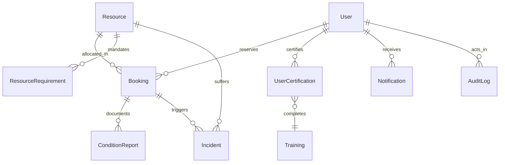
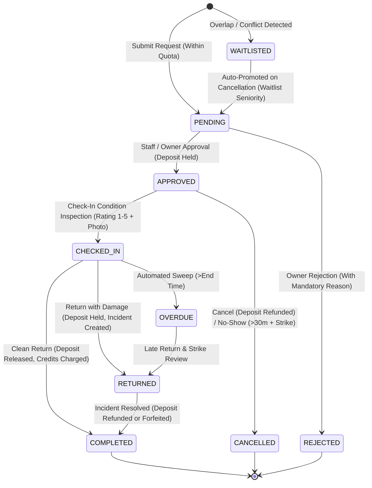

# CampusShare 🎓🏛️
> **Unlock Underused Campus Equipment and Spaces with Fair Allocation, Safety Certifications, and Lifecycle Accountability.**

[](https://nextjs.org/)
[](https://react.dev/)
[](https://www.prisma.io/)
[](https://tailwindcss.com/)
[](https://vitest.dev/)
[](https://www.typescriptlang.org/)
[](https://zod.dev/)
[](https://platform.openai.com/)

---

## 📌 Executive Summary & Hackathon Scope

University campuses invest hundreds of millions in specialized scientific instruments, fabrication facilities, high-performance computing clusters, and multimedia suites. Yet, up to **60% of specialized equipment sits idle outside peak lab hours**, while researchers and student project teams face multi-week backlogs due to departmental silos, opaque scheduling, lack of safety verification, and zero accountability for damage or delays.

**CampusShare** solves this systemic problem for Northfield University by delivering an end-to-end platform for cross-departmental equipment and facility sharing featuring:

1. **Gatekept Safety & Eligibility Verification**: Automated checking of safety training credentials, department permissions, account standing, and credit deposits before any reservation can be placed.
2. **Anti-Hoarding Fairness Engine**: Priority scoring algorithms (`base 100 - recent usage + waitlist seniority + academic purpose bonus - conduct strikes`) to eliminate equipment hoarding and ensure equitable access, combined with campus-wide 20h weekly caps and automated monthly credit grants.
3. **Double-Checked Condition Lifecycle**: Mandatory condition inspection reports at check-in (with 15-minute grace window) and return (with real image upload and rating comparisons). Damage automatically creates an incident and holds the deposit.
4. **Automated Incident Adjudication & Overdue Sweeps**: Background sweep engine detecting overdue sessions, auto-cancelling 30-minute no-shows with conduct strikes, sending 1-hour reminders, and auto-completing clean returns.
5. **Auto-Promoting Priority Waitlist**: Dynamic recalculation of waitlist scores based on waiting seniority (`hoursWaiting * 2`), with automatic promotion to `PENDING` review upon cancellation of approved slots.
6. **Immutable, Tamper-Evident Audit Ledger**: Append-only transactional audit logs recording every state transition, review note, condition inspection, and manager penalty in the same transaction.
7. **AI-Assisted Operations with Human-in-the-Loop**: Smart natural language resource matching, automated incident root-cause summaries with suggested severity, safety certificate document review, and suspicious usage anomaly detection (cached in DB to eliminate repeat API costs, with deterministic heuristic fallbacks for offline operation).
8. **Enterprise Security & Access Control**: Gated demo login (`DEMO_MODE=true`), secret-authenticated cron endpoint (`CRON_SECRET`), live session re-verification against DB preventing stale permissions, and strict resource ownership boundaries.

---

## 🏛️ System Architecture & Workflow

### Entity-Relationship Architecture



### Complete Booking Lifecycle State Machine



---

## 🛠️ Tech Stack & Key Libraries

- **Framework**: [Next.js 15.5.28](https://nextjs.org/) (App Router, React Server Components, Server Actions, `revalidatePath`)
- **UI Library**: [React 19.0.0](https://react.dev/)
- **Styling**: [Tailwind CSS v4](https://tailwindcss.com/) (`@tailwindcss/postcss`) with responsive, accessible layout
- **Database & ORM**: [Prisma 6.9.0](https://www.prisma.io/) with SQLite (`dev.db`)
- **Validation**: [Zod 4.6.7](https://zod.dev/) for all server actions and API contracts
- **Authentication & RBAC**: Stateless signed JWT cookies (`jose`) with live database validation on each protected action, granular roles (`STUDENT`, `RESEARCHER`, `OWNER`, `MANAGER`, `ADMIN`)
- **Password Security**: [bcryptjs](https://github.com/dcodeIO/bcrypt.js) salted hash encryption
- **AI Integrations**: OpenAI GPT-4o-mini (`openai 7.45.1`) with deterministic heuristic fallbacks for offline execution
- **Testing**: [Vitest 5.0.5](https://vitest.dev/) with 23 automated unit and integration tests

---

## 👥 Demo Accounts Matrix (One-Click Switcher in Navbar)

For rapid judging, a **one-click role switcher** is integrated directly into the top navigation bar. You can also sign in manually using any of the seeded credentials:

| Role | Email | Password | Department | Credits | Strikes | Pre-Configured Profile & Persona |
| :--- | :--- | :--- | :--- | :---: | :---: | :--- |
| **STUDENT** | `alice@northfield.edu` | `Alice2024!` | Engineering | 100 | 0 | Ideal student: has all safety certifications (Laser, 3D Printing), verified campus standing. |
| **STUDENT** | `bob@northfield.edu` | `Bob2024!` | Engineering | 45 | 1 | Edge case student: missing laser safety cert, has an overdue booking and conduct strike. |
| **RESEARCHER** | `carol@northfield.edu` | `Carol2024!` | Biology | 120 | 0 | Academic researcher: receives research multiplier (+25 priority bonus) in waitlists. |
| **OWNER** | `dave@northfield.edu` | `Dave2024!` | Engineering | 150 | 0 | Equipment owner & lab faculty: manages Engineering equipment (Laser, 3D Printer), reviews reservation requests. |
| **MANAGER** | `eve@northfield.edu` | `Eve2024!` | Engineering | 200 | 0 | Department manager: resolves incident disputes, reviews AI summaries, settles held deposits. |
| **ADMIN** | `frank@northfield.edu` | `Frank2024!` | Campus | 500 | 0 | Campus administrator: verifies accounts, edits fairness policies, reviews usage analytics, inspects global audit logs. |

---

## 🚀 Quickstart & Setup Guide

### 1. Prerequisites
- Node.js 18.18+ or 20+
- npm (v9+)

### 2. Environment Configuration
Create `.env` based on `.env.example`:
```env
DATABASE_URL="file:./dev.db"
SESSION_SECRET="super-secret-campus-share-jwt-key-32-chars-long!"
OPENAI_API_KEY="" # Optional: app runs 100% offline with heuristic fallbacks
DEMO_MODE="true"
CRON_SECRET="campus-share-cron-secret-2026"
```

### 3. Installation & Database Setup
```bash
npm install
npm run db:reset
```

### 4. Run Test Suite
```bash
npm test
```

### 5. Start Development Server
```bash
npm run dev
```
Open [http://localhost:3000](http://localhost:3000) in your browser.

---

## 🧭 Step-by-Step Judge Walkthrough

### Journey 1: Gated Safety & Equipment Reservation
1. Log in as **Alice** (Student) via the one-click switcher.
2. Navigate to `/resources`. Use the **AI Smart Search** to type *"high precision 3D prototype printing"*.
3. Click on the **UltiMaker S5 3D Printer**. Notice Alice meets all prerequisites (3D Printing Safety Credential verified).
4. Select a weekday reservation slot and submit. The booking enters status **PENDING**, and the priority score breakdown is displayed.

### Journey 2: Owner Review & Approval
1. Switch to **Dave** (Owner) using the navbar role switcher.
2. Go to `/manage`. Alice's reservation request appears in the Pending Approvals queue.
3. Review the applicant's priority breakdown (125.0 score with coursework bonus). Enter an approval note and click **Approve Booking**.
4. The reservation transitions to **APPROVED**, and the security deposit is escrowed.

### Journey 3: Check-In Condition Inspection with Photo Evidence
1. Switch back to **Alice**.
2. Navigate to `/bookings` and select the approved reservation.
3. Click **Check-In Inspection**. Verify the checklist items (bed cleaned, filament loaded), choose condition rating (5 ★), upload or attach a condition photo, and click **Confirm & Check In**.
4. The reservation transitions to **CHECKED_IN**, and the condition report is recorded.

### Journey 4: Return Condition Inspection & Damage Incident
1. Click **Return Condition Checkout**.
2. Simulate a damage scenario: select rating (2 ★), enter notes *"Bed scratched and nozzle jammed"*, and confirm checkout.
3. The platform automatically flags degradation, creates a **DAMAGE Incident**, transitions booking to **RETURNED**, and securely holds the deposit.

### Journey 5: Manager Incident Resolution & Deposit Settlement
1. Switch to **Eve** (Manager).
2. Go to `/incidents` or click the notification.
3. Review the **AI Incident Summary** (*"AI suggestion — requires human review"*).
4. Select resolution action: apply a warning, 1 conduct strike, or credit deduction (guarded against negative balances). Choose deposit settlement (**Refund** or **Forfeit**).
5. Click **Resolve Incident**. The incident is resolved, the deposit is settled, and the booking transitions to **COMPLETED**.

### Journey 6: Admin Governance & Policy Control
1. Switch to **Frank** (Admin).
2. Navigate to `/admin`.
3. Explore the **Account Verification** tab to verify or revoke student/owner access.
4. Explore the **Fairness Policy** tab to edit weekly hour caps (e.g. 20h) or monthly credit grants.
5. Inspect the **Usage Statistics** and the immutable **Audit Ledger**.

---

## ⚖️ Fairness Engine & Anti-Hoarding Architecture

```
Priority Score = Base (100)
               - Recent Usage (2.5 pts / hr in last 30 days)
               + Waitlist Seniority (2 pts / hr waiting, max 30)
               + Purpose Multiplier (+25 Research, +20 Coursework, +5 Club)
               - Conduct Strikes (25 pts / strike)
               + Role Bonus (+15 Researcher, +10 Student)
```

- **Cross-Resource Quota**: 20-hour maximum weekly booking cap across all campus assets per user.
- **Monthly Credit Grants**: Automated credit allocation per calendar month to ensure active students always have reservation credits.
- **Automatic Waitlist Rebalancing**: When active bookings cancel, candidate waitlist scores recalculate dynamically with waitlist age bonus, and the highest priority candidate is promoted to `PENDING` review.

---

## 🤖 AI Human-in-the-Loop Contract

All AI features in CampusShare follow strict **Human-in-the-Loop (HITL)** safety protocols:
- **Exact Contract Disclaimer**: Every AI-generated output is accompanied by:
  ```
  AI suggestion — requires human review
  ```
- **Advisory Only**: AI suggestions never unilaterally approve, reject, debit user deposits, assign strikes, or lock accounts.
- **Database Caching & Anonymization**: AI review results for certifications and user usage assessments are cached directly in the database (`UserCertification.aiEvaluation`, `User.aiUsageAssessment`), eliminating duplicate API costs and anonymizing user identities sent to LLMs.
- **Zero-Dependency Heuristic Fallback**: If OpenAI API keys are not supplied in `.env`, CampusShare transparently falls back to deterministic heuristic algorithms (keyword scoring, rule-based incident summaries, and regex parsers) ensuring zero setup friction.

---

## 💻 NPM Scripts Reference

| Command | Description |
| :--- | :--- |
| `npm run dev` | Starts Next.js development server on `http://localhost:3000` |
| `npm test` | Runs the full Vitest automated test suite (23 unit, state, conflict, and integration tests) |
| `npm run build` | Compiles production Next.js application, verifying strict TypeScript types |
| `npm start` | Launches the built production server |
| `npm run db:push` | Synchronizes the Prisma schema directly to `dev.db` |
| `npm run db:seed` | Seeds realistic campus scenarios, demo accounts, and lifecycle bookings |
| `npm run db:reset` | Resets SQLite database schema and repopulates seed records (`db:push && db:seed`) |

---

## 🧪 Automated Test Suite (Vitest)

```bash
npm test
```

### 23 Tests Across 5 Test Suites:
- `__tests__/integration.test.ts` (5 tests):
  - Full lifecycle state machine (Request -> Approve -> Check-in -> Return -> Complete)
  - Double-booking prevention & auto-waitlisting of overlapping pending requests
  - Transparent waitlist auto-promotion with re-checked eligibility & owner notification
  - Overdue and no-show sweeps with conduct strike penalty
  - Role-based access control and department boundary checks
- `__tests__/eligibility.test.ts` (6 tests):
  - Verified user certification gates
  - Missing mandatory safety trainings
  - Expired certifications
  - Suspended accounts
  - Conduct strike limits (>= 3 strikes)
  - Minimum credit balance requirement
- `__tests__/fairness.test.ts` (5 tests):
  - Priority score computation
  - Research purpose bonus (+25)
  - Recent usage penalty (-2.5 per hour)
  - Conduct strike deduction (-25 per strike)
  - Weekly hour quota checks (anti-hoarding)
- `__tests__/conflicts.test.ts` (4 tests):
  - Overlap detection on same resource
  - Back-to-back non-overlapping bookings
  - Max hours per reservation checks
  - Offline maintenance status check
- `__tests__/bookingState.test.ts` (3 tests):
  - Condition degradation detection
  - Waitlist candidate ordering by priority score and timestamp
  - Security deposit escrow and refund conditions

---

## 📄 License
Built for the Northfield Campus Innovation Challenge. Released under the MIT License.
