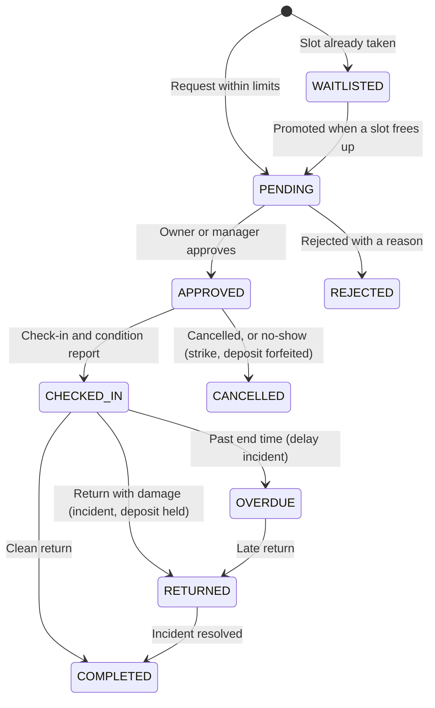

# CampusShare

**A trusted way for a university campus to share its underused labs, equipment and spaces — with safety checks, fair allocation, condition records and a complete audit trail.**

Built for the *Unlock Underused Equipment and Spaces* challenge. The prototype serves one campus ("Northfield University") and walks a resource through its whole sharing lifecycle, from listing to return, with a person in charge of every important decision.

[](https://nextjs.org/)
[](https://react.dev/)
[](https://www.prisma.io/)
[](https://tailwindcss.com/)
[](https://www.typescriptlang.org/)
[](#tests)

---

## Screenshots

**Discover** — search, filters and plain-language AI matching, clearly labelled as a suggestion.


**Check eligibility before requesting** — what you meet, and exactly what is still missing.


**See the cost, the schedule and your fairness score up front** — weekly availability, credits and deposit, and the priority score that ranks competing requests.


**Owner stays in control** — the review queue shows eligibility, conflicts and the priority score. Approving or rejecting needs a written reason.


**Condition record at check-in** — who, what state, and the inspection checklist, with the return inspection pending.


**Every score and decision is explained and logged** — the full priority breakdown, then an append-only history of who did what and why.


**Incidents** — a damage report with an AI summary that is labelled as a suggestion only.


**A manager decides** — resolution notes, a penalty choice, and whether the held deposit is refunded or forfeited.


**Verification with AI as an advisor, not the decider** — the AI pre-screens a safety certificate and here even recommends rejecting it; an administrator makes the final call.


---

## Run it in two minutes

You need Node.js 18.18+ (20+ recommended) and npm.

```bash
git clone https://github.com/Shrey-Vhr/Code-Conqueror.git
cd Code-Conqueror
cp .env.example .env        # Windows PowerShell: Copy-Item .env.example .env
npm install
npm run db:reset            # creates the SQLite database and loads the demo campus
npm run dev                 # http://localhost:3000
```

Open <http://localhost:3000>, press **Sign in**, then pick any demo account with one click. Once signed in, the **Switch user** menu in the top bar jumps between roles without logging out.

No API key, database server or other setup is needed. For a steadier, faster run use `npm run build && npm start` instead of `npm run dev`.

### Environment (`.env`)

| Variable | Purpose |
| :--- | :--- |
| `DATABASE_URL` | SQLite file. Default `file:./dev.db` works as is. |
| `SESSION_SECRET` | Signs login cookies. **Required in production.** |
| `DEMO_MODE` | `true` enables the one-click demo logins and lifts the "check in no earlier than 15 minutes before start" rule so a reviewer can finish the whole journey in one sitting. Set to `false` for a real deployment. |
| `CRON_SECRET` | Protects `/api/cron` (the overdue sweep). |
| `CAMPUS_TIMEZONE` | Time zone used for opening hours and booking times (default `America/New_York`). Times you pick in the booking form are campus time. |
| `OPENAI_API_KEY` | Optional. Without it every AI feature uses a built-in rule-based fallback, so nothing breaks. |

---

## Demo accounts

| Role | Email | Password | What to try |
| :--- | :--- | :--- | :--- |
| Student | `alice@northfield.edu` | `Alice2024!` | Fully certified. Already waitlisted for the laser cutter. |
| Student | `bob@northfield.edu` | `Bob2024!` | Missing the laser-cutter certification (a request is pending), has 1 strike and an overdue oscilloscope. |
| Researcher | `carol@northfield.edu` | `Carol2024!` | Holds an approved laser-cutter slot; research use scores higher priority. |
| Owner | `dave@northfield.edu` | `Dave2024!` | Owns Engineering equipment, lists resources, approves requests. |
| Manager | `eve@northfield.edu` | `Eve2024!` | Resolves incidents, settles deposits and penalties. |
| Admin | `frank@northfield.edu` | `Frank2024!` | Verifies certifications and accounts, edits fairness policy, reads the audit ledger. |

These are demo credentials for the seeded sample campus only.

---

## Try the full journey (about 5 minutes)

This follows the ten steps in the challenge. Pick the account from the **Switch user** menu at each step.

| # | Challenge step | Do this |
| :-: | :--- | :--- |
| 1 | Owner lists a resource | As **Dave**: *Resources → List New Resource*. Fill in the details, opening hours, deposit, limits and any required training, then save. |
| 2 | User discovers it and checks eligibility | As **Bob**: *Resources*, try the AI match box ("laser cut acrylic"), open **Epilog Fusion Pro 48 Laser Cutter**. The eligibility checklist shows his certification is still pending. |
| 3 | Verification | As **Frank**: *Admin → Credentials Review*. Read the AI pre-screen (advisory only; with an OpenAI key it may even suggest rejecting) and decide: **Verify & Grant** or **Reject** on Bob's certificate. |
| 4 | User requests a booking | As **Bob**: reopen the laser cutter. It now says "Fully Eligible". Choose a weekday slot of 2 hours or less and press **Request Booking**. The cost, deposit and fairness score breakdown are shown first. |
| 5 | Owner reviews | As **Dave**: *Manage → Booking Approval Queue*. Compare eligibility, conflicts and priority score, then approve (a decision note is required). Rejecting also needs a reason. |
| 6 | Approved, rejected or waitlisted | Request the same slot as **Carol's** existing booking to see the waitlist, with a position and an explained score. |
| 7 | Check-in with initial condition | As **Bob**: *Bookings → open the booking → Check-In Inspection*. Tick the checklist, rate the condition 5, add a photo and confirm. |
| 8 | Return with final condition | Press **Return Condition Check-out**, rate the condition 2 and add notes. |
| 9 | Damage, delay or conflict handled | A **DAMAGE** incident is drafted automatically with an AI summary (labelled "requires human review") and the deposit is held. As **Eve**: *Manage → Incident Queue → Review & Resolve*, choose a penalty and refund or forfeit the deposit. The oscilloscope shows the delay path. |
| 10 | Both parties see the history | Bob's booking page, and the same page opened by Dave from his notifications, show one timeline of decisions, condition reports and incidents. **Frank's** *Admin → Audit Ledger* shows every action with who did it and why. |

**Waitlist promotion:** sign in as **Carol**, cancel her approved laser-cutter booking, then check Alice's notifications. Alice moves from the waitlist to the owner's review queue.

---

## How it meets the brief

| Expectation | Where it lives |
| :--- | :--- |
| Listings with availability, location, conditions and rules | Owner form (`/resources/new`), resource page with weekly availability calendar |
| Search, filtering and intelligent matching | Filters, an "I'm eligible" toggle and natural-language AI matching on `/resources` |
| Profiles and verification | Admin verifies accounts and certifications; users submit training evidence on `/profile` |
| Eligibility checks | `lib/eligibility.ts`: verified account, standing, credits, role, department, unexpired training. Missing items are listed before a user can request |
| Approval, rejection and waitlist | `lib/bookingService.ts` with required decision reasons |
| Conflicts and competing requests | Overlap and opening-hours checks; competing pending requests are moved to the waitlist when one is approved |
| Check-in, check-out and condition reports | Before/after ratings, checklists and photos; a rating drop drafts an incident |
| Damage, delay and incident reporting | Incident queue, manager resolution, deposit settlement |
| Notifications | In-app bell and `/notifications`: approvals, rejections, waitlist moves, 1-hour reminders, cancellations (by staff, or by a user with an approved slot), overdue |
| Fair-usage measures | Weekly hour caps, per-resource limits, credits and deposits, transparent priority score, no-show strikes |
| Roles | Student, Researcher, Owner, Manager, Admin, enforced on the server |
| Audit history | Append-only log written in the same database transaction as each change |
| Privacy and security | See below |

---

## Fair allocation

When demand exceeds availability, requests are ranked by a score that is shown to the user and the reviewer:

```
Priority = 100
         − 2.5 × hours used in the last 30 days
         + waitlist time bonus (up to +30)
         + purpose bonus (Research +25, Coursework +20, Club +5)
         + role bonus (Researcher +15, Student +10)
         − 25 × conduct strikes
```

Alongside it: a campus-wide weekly hour cap, per-resource booking limits, a monthly credit grant, and a deposit held until a clean return. An administrator can change the weights and caps from *Admin → Fairness Policy*, and every change is logged. The score ranks requests; **a person still approves or rejects.**

## AI, with a person in charge

AI is used where it saves time, and never decides anything:

- matching a plain-language need to resources
- pre-screening certification evidence
- summarising incidents and suggesting a severity
- explaining unusual usage patterns to an administrator

Every AI output carries the label **"AI suggestion — requires human review"**. AI never approves, rejects, charges, penalises or suspends. Names are removed from usage data before it is sent to the model, and results are stored so they are not requested again. With no `OPENAI_API_KEY` set, the app uses plain rule-based versions of the same features.

## Security and privacy

- Every server action checks the signed-in user's role and, where relevant, who owns the booking or resource. The user is re-read from the database on each request, so a suspension or role change takes effect immediately.
- Passwords are stored as bcrypt hashes; sessions are signed, HTTP-only cookies.
- Inputs are validated with Zod.
- Users see their own bookings. Owners and managers see only what they need to review a request; certification documents are visible to administrators.
- The overdue sweep endpoint needs a secret, and the demo login can be switched off with `DEMO_MODE=false`.
- The audit log has no update or delete path in the application.

---

## Booking lifecycle



## Tech stack

Next.js 15 (App Router, Server Actions) · React 19 · TypeScript · Prisma 6 with SQLite · Tailwind CSS 4 · Zod 4 · jose (signed sessions) · bcryptjs · OpenAI SDK (optional) · Vitest.

Code layout: `app/` pages and server actions, `components/` shared UI, `lib/` domain logic (eligibility, conflicts, fairness, booking service, incident service, overdue sweep, AI), `prisma/` schema and seed data, `__tests__/` tests.

## Tests

```bash
npm test
```

26 tests in 5 files. They run against a temporary copy of the database, so your demo data is never touched.

- **Eligibility:** certifications, expiry, suspension, strikes, minimum credits.
- **Fairness:** priority score, weights, strikes.
- **Conflicts:** overlaps, back-to-back slots, opening hours, maintenance.
- **Booking state:** condition-drop detection, waitlist ordering, deposit handling.
- **Integration (real database):** the full lifecycle, double-booking prevention, waitlist promotion, overdue and no-show sweeps, incident resolution and deposit settlement, and role boundaries.

## Honest limitations

This is a hackathon prototype for a single campus.

- Notifications are in-app only (no email or SMS).
- Certification evidence is a text note, not an uploaded document. Condition photos are resized and stored in the database rather than a file store.
- One institution only, with a fixed campus time zone.
- SQLite suits a demo; a real deployment would use a hosted database.
- The demo logins are for evaluation only; turn `DEMO_MODE` off elsewhere.

## License

MIT.
