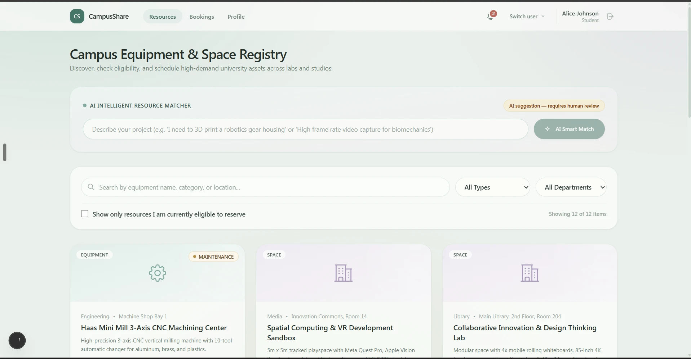
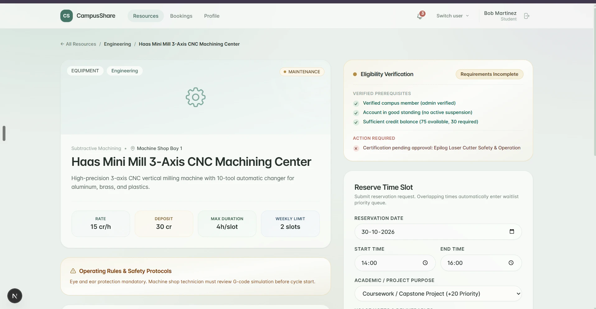
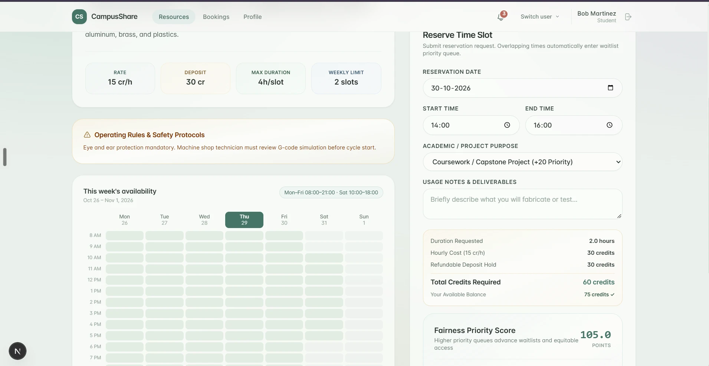
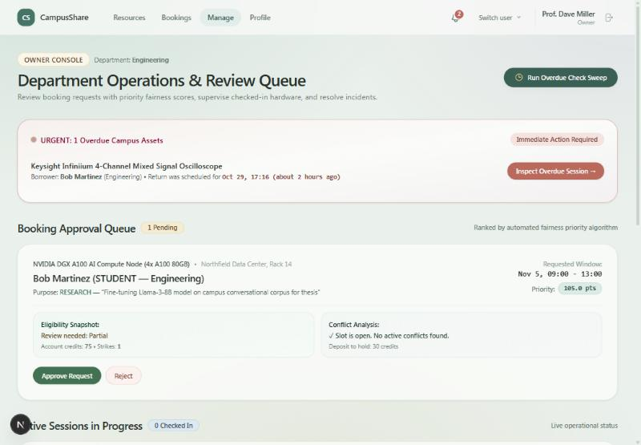
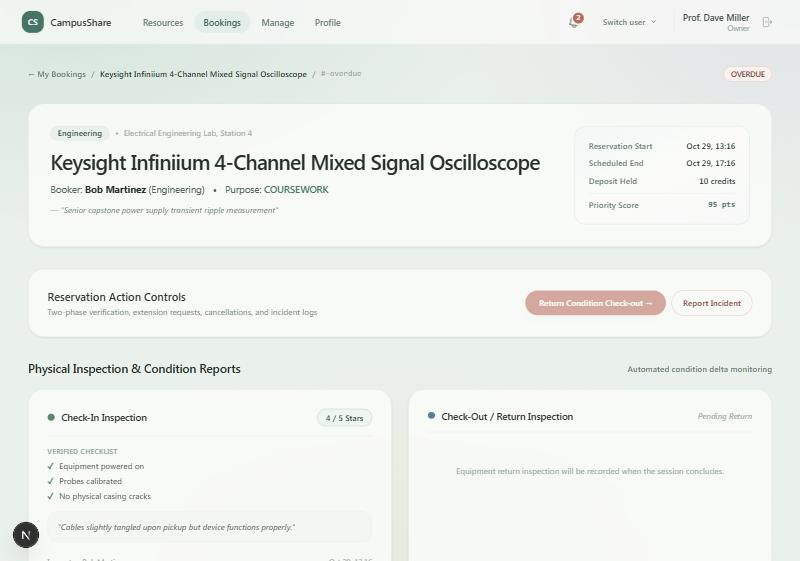
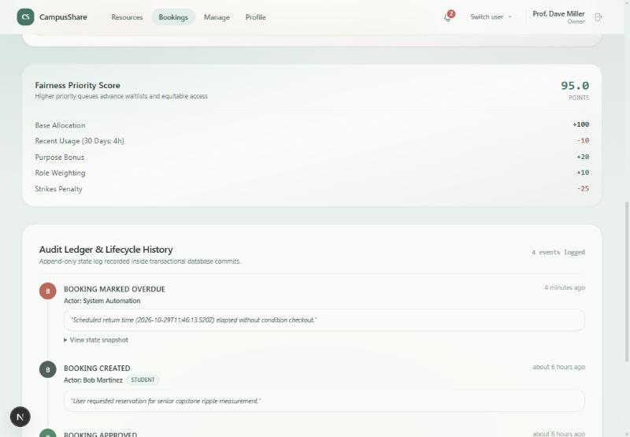
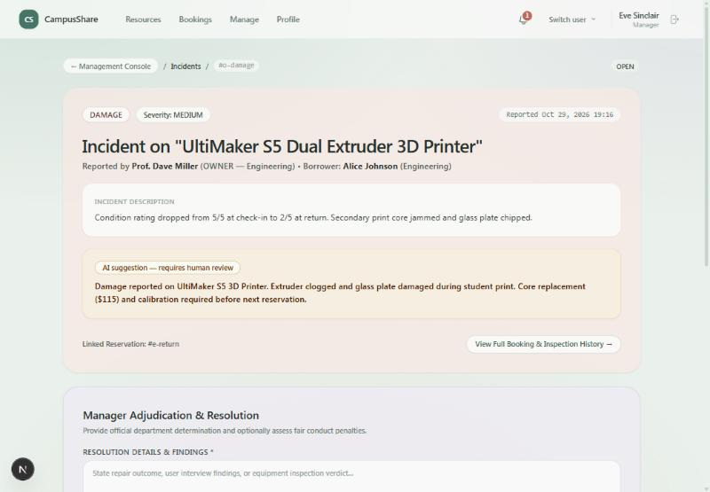
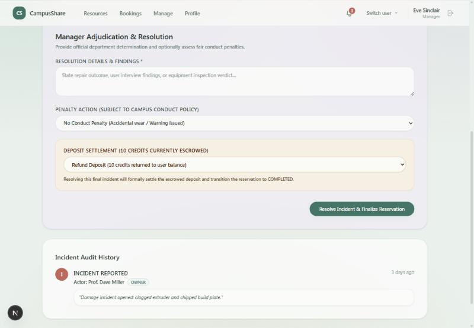
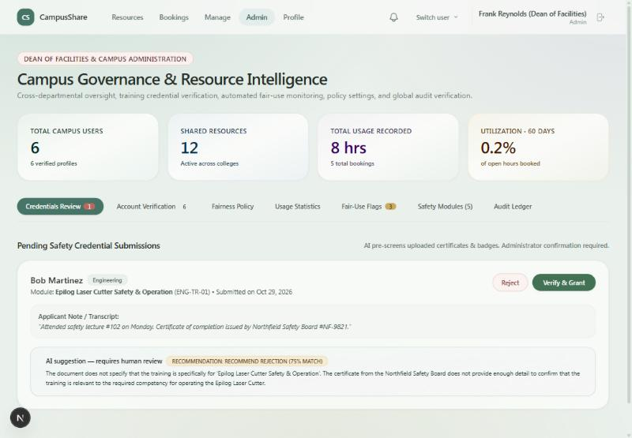
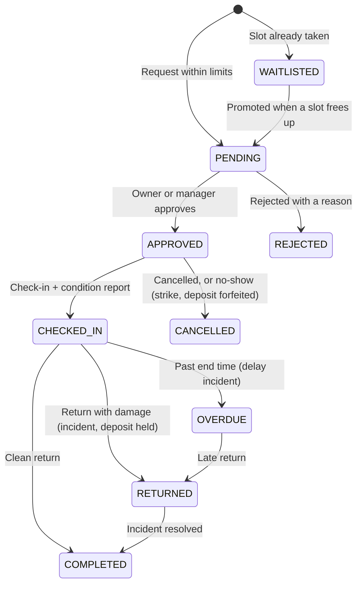

<div align="center">

# CampusShare

**Share a campus's idle labs, equipment and spaces — safely, fairly, and with a full paper trail.**

Built for the *Unlock Underused Equipment and Spaces* challenge.

[](https://nextjs.org/)
[](https://react.dev/)
[](https://www.typescriptlang.org/)
[](https://www.prisma.io/)
[](#tests)

[Quick start](#quick-start) · [5-minute tour](#take-the-tour) · [Screenshots](#screenshots) · [How it works](#how-it-works) · [Brief → code](#how-it-meets-the-brief)

</div>

---

## The problem

Colleges and labs own expensive equipment that sits unused for long stretches, while students and early-stage teams can't afford to access it. An ordinary booking calendar doesn't solve this, because sharing institutional property needs **trust**: who is allowed to use what, who approves it, what condition it was in, and what happens when something breaks or comes back late.

## What CampusShare does

One campus ("Northfield University") shares its resources end to end, with a person in charge of every important decision:

| | |
| :--- | :--- |
| **List** | Owners publish equipment and spaces with opening hours, rules, deposits and the training required. |
| **Discover** | Search, filter, and plain-language AI matching ("I need to laser-cut acrylic"). |
| **Qualify** | Eligibility is checked *before* a request: verified account, standing, credits, department, unexpired safety training. Missing items are listed. |
| **Book fairly** | Competing requests are ranked by a transparent priority score, with caps, credits and deposits that stop hoarding. |
| **Decide** | Owners and managers approve, reject or waitlist — always with a written reason. |
| **Use** | Check-in and return with a condition checklist, rating and photo. A worse condition at return drafts a damage incident automatically. |
| **Resolve** | Delays, damage and conflicts go to a manager, who settles penalties and the held deposit. |
| **Trace** | Every action is written to an append-only audit log, visible to the people involved. |

---

## Quick start

Needs **Node.js 18.18+** and npm. No API key, database server or other setup.

```bash
git clone https://github.com/Shrey-Vhr/Code-Conqueror.git
cd Code-Conqueror
cp .env.example .env        # PowerShell: Copy-Item .env.example .env
npm install
npm run db:reset            # creates the SQLite database + demo campus
npm run dev                 # → http://localhost:3000
```

Press **Sign in**, then click any demo account. After that, the **Switch user** menu in the top bar changes role instantly.

> **Tip:** the first visit to each page is slow in dev mode (Next.js compiles on demand). For a smooth run, stop the dev server and use `npm run build && npm start`. Don't run `build` while `dev` is running.

<details>
<summary><b>Environment variables</b></summary>

| Variable | Purpose |
| :--- | :--- |
| `DATABASE_URL` | SQLite file. Default `file:./dev.db` works as is. |
| `SESSION_SECRET` | Signs login cookies. **Required in production.** |
| `DEMO_MODE` | `true` enables one-click demo logins and lifts the "check in no earlier than 15 minutes before start" rule so a reviewer can finish the journey in one sitting. Set `false` for a real deployment. |
| `CRON_SECRET` | Protects `/api/cron` (the overdue sweep). |
| `CAMPUS_TIMEZONE` | Time zone for opening hours and booking times (default `America/New_York`). Times you pick in the form are campus time. |
| `OPENAI_API_KEY` | Optional. Without it, every AI feature uses a built-in rule-based fallback. |

</details>

### Deploy

CampusShare is one Node service with a local SQLite file, so it needs a host with a writable disk (Render, Railway, Fly.io or a VPS). Serverless hosts such as Vercel are not a fit with SQLite.

**Render (free), about 5 minutes:** push the repo to GitHub, then in Render choose *New → Blueprint*, pick the repo, and Render reads `render.yaml`. When asked, paste an `OPENAI_API_KEY` (optional; leave it blank to use the rule-based fallbacks). It runs `npm run start:prod`, which creates the database, loads the demo campus on first boot, and starts the app.

On Render's free plan the disk is ephemeral and the service sleeps when idle, so after a restart the demo campus is simply reseeded and the first page takes about a minute to wake up. Use a host with a persistent volume if you want data to survive restarts.

For any other host: build with `npm install --include=dev && npm run build`, start with `npm run start:prod`, and set `DATABASE_URL=file:./dev.db`, `SESSION_SECRET`, `CRON_SECRET`, `DEMO_MODE=true`, `CAMPUS_TIMEZONE` and (optionally) `OPENAI_API_KEY`.

### Demo accounts

| Role | Email | Password | Good for |
| :--- | :--- | :--- | :--- |
| Student | `alice@northfield.edu` | `Alice2024!` | Fully certified; already waitlisted for the laser cutter |
| Student | `bob@northfield.edu` | `Bob2024!` | Certificate pending, 1 strike, overdue oscilloscope |
| Researcher | `carol@northfield.edu` | `Carol2024!` | Holds an approved laser slot; research scores higher |
| Owner | `dave@northfield.edu` | `Dave2024!` | Lists resources, approves requests |
| Manager | `eve@northfield.edu` | `Eve2024!` | Resolves incidents, settles deposits |
| Admin | `frank@northfield.edu` | `Frank2024!` | Verifies people, edits fairness policy, reads the audit log |

Demo credentials for the seeded sample campus only.

---

## Take the tour

The ten steps from the challenge, in order. Choose the account from **Switch user** at each step. About five minutes.

| # | Step | What to do |
| :-: | :--- | :--- |
| 1 | Owner lists a resource | **Dave** → *Resources → List New Resource*. Add details, opening hours, deposit, limits, required training. |
| 2 | User checks eligibility | **Bob** → try the AI box ("laser cut acrylic"), open **Epilog Fusion Pro 48 Laser Cutter**. His certificate is still pending. |
| 3 | Verification | **Frank** → *Admin → Credentials Review*. Read the AI pre-screen (advisory; with an OpenAI key it may even suggest rejecting) and decide: **Verify & Grant** or **Reject**. |
| 4 | Booking request | **Bob** → now "Fully Eligible". Pick a weekday slot of 2 h or less → **Request Booking**. Cost, deposit and fairness score are shown first. |
| 5 | Owner reviews | **Dave** → *Manage → Booking Approval Queue*. Compare eligibility, conflicts and score; approve with a note (reasons are required). |
| 6 | Approve / reject / waitlist | As Bob, request the same slot as **Carol's** booking to see the waitlist, with a position and an explained score. |
| 7 | Check-in + initial condition | **Bob** → *Bookings →* the booking → **Check-In Inspection**. Tick the checklist, rate **5**, add a photo, confirm. |
| 8 | Return + final condition | **Return Condition Check-out**, rate **2**, add notes. |
| 9 | Damage / delay handled | A **DAMAGE** incident is drafted with an AI summary. **Eve** → *Manage → Incident Queue → Review & Resolve*: choose a penalty and refund or forfeit the deposit. The seeded oscilloscope shows the *delay* path. |
| 10 | Both sides see the history | Bob's booking page, and the same page opened by Dave from his notifications, show one timeline. **Frank's** *Admin → Audit Ledger* shows everything. |

**Bonus — waitlist promotion:** as **Carol**, cancel her approved laser booking, then check Alice's notifications. Alice moves from the waitlist to the owner's review queue.

---

## Screenshots

<table>
  <tr>
    <td width="33%"><br><sub><b>Discover</b> — search, filters, AI matching</sub></td>
    <td width="33%"><br><sub><b>Qualify</b> — what's met, what's missing</sub></td>
    <td width="33%"><br><sub><b>Plan</b> — schedule, cost, fairness score</sub></td>
  </tr>
  <tr>
    <td><br><sub><b>Decide</b> — owner queue with conflicts and score</sub></td>
    <td><br><sub><b>Record</b> — check-in condition report</sub></td>
    <td><br><sub><b>Explain</b> — score breakdown + audit ledger</sub></td>
  </tr>
  <tr>
    <td><br><sub><b>Report</b> — incident, AI summary as suggestion</sub></td>
    <td><br><sub><b>Resolve</b> — penalty and deposit settlement</sub></td>
    <td><br><sub><b>Verify</b> — AI advises, admin decides</sub></td>
  </tr>
</table>

---

## How it works

### Booking lifecycle



### Fair allocation

When demand exceeds availability, requests are ranked by a score shown to both the user and the reviewer:

```
Priority = 100
         − 2.5 × hours used in the last 30 days
         + waitlist time bonus            (up to +30)
         + purpose bonus                  (Research +25 · Coursework +20 · Club +5)
         + role bonus                     (Researcher +15 · Student +10)
         − 25 × conduct strikes
```

Alongside it: a campus-wide weekly hour cap (default 20 h), per-resource booking limits, a monthly credit grant, deposits held until a clean return, and automatic strikes for no-shows. An admin can change every weight and cap in *Admin → Fairness Policy*, and each change is logged. The score **ranks** requests — a person still approves or rejects.

### AI, with a person in charge

AI is used where it saves time and never decides anything.

| Used for | Never used for |
| :--- | :--- |
| Matching a plain-language need to resources | Approving or rejecting a booking |
| Pre-screening certificate evidence | Charging credits or deposits |
| Summarising incidents, suggesting a severity | Assigning strikes or penalties |
| Explaining unusual usage to an admin | Suspending anyone |

Every AI output carries **"AI suggestion — requires human review"**. Names are removed before usage data is sent to the model, and results are stored so they aren't requested twice. With no `OPENAI_API_KEY`, the app uses rule-based versions of the same features.

### Security and privacy

- **Server-side access control:** every action checks the caller's role and, where it matters, who owns the booking or resource. The user is re-read from the database on each request, so a suspension takes effect immediately.
- **Credentials:** bcrypt-hashed passwords; signed, HTTP-only session cookies; all inputs validated with Zod.
- **Least information:** users see their own bookings; owners and managers see only what they need to review; certificate documents are visible to admins.
- **Guarded endpoints:** the overdue-sweep endpoint needs a secret; demo logins can be switched off with `DEMO_MODE=false`.
- **Audit log:** append-only, written in the same database transaction as each change, with no update or delete path in the app.

### Roles

| Role | Can |
| :--- | :--- |
| **Student / Researcher** | Browse, request, check in/out, cancel, report incidents, submit training evidence |
| **Owner** | List resources, review requests for their own resources |
| **Manager** | Review and resolve incidents for their department, settle deposits and penalties |
| **Admin** | Verify accounts and certificates, edit fairness policy, view analytics and the global audit log |

---

## How it meets the brief

| Expectation | Where |
| :--- | :--- |
| Listings with availability, location, rules | `/resources/new`, resource page with weekly calendar |
| Search, filtering, intelligent matching | Filters, "I'm eligible" toggle, AI match on `/resources` |
| Profiles and verification | `/profile`, *Admin → Account Verification / Credentials Review* |
| Eligibility checks | `lib/eligibility.ts` |
| Approval, rejection, waitlist | `lib/bookingService.ts` — decisions require a reason |
| Competing requests and conflicts | Overlap and opening-hours checks; losers move to the waitlist |
| Check-in / check-out, condition reports | Ratings, checklists, photos; a drop drafts an incident |
| Damage, delay, incidents | Incident queue, `lib/incidentService.ts`, deposit settlement |
| Notifications | Bell + `/notifications`: approvals, rejections, waitlist moves, 1-hour reminders, cancellations, overdue |
| Fair-usage measures | Caps, credits, deposits, priority score, no-show strikes |
| Role-based access | Student, Researcher, Owner, Manager, Admin — enforced server-side |
| Auditable history | Append-only audit log |
| Privacy and security | See above |

---

## Under the hood

**Stack:** Next.js 15 (App Router, Server Actions) · React 19 · TypeScript · Prisma 6 + SQLite · Tailwind CSS 4 · Zod 4 · jose · bcryptjs · OpenAI SDK (optional) · Vitest

```
app/          pages and server actions (resources, bookings, manage, incidents, admin, profile)
components/   shared UI (cards, badges, nav, score breakdown, audit timeline)
lib/          domain logic: eligibility, conflicts, fairness, bookingService,
              incidentService, overdue sweep, notifications, audit, AI
prisma/       schema + seed data for the demo campus
__tests__/    unit and integration tests
```

### Tests

```bash
npm test
```

26 tests in 5 files, run against a temporary copy of the database so your demo data is never touched: eligibility, fairness scoring, conflict detection, booking state, and integration tests on a real database covering the full lifecycle, double-booking prevention, waitlist promotion, overdue and no-show sweeps, incident resolution with deposit settlement, and role boundaries.

| Command | What it does |
| :--- | :--- |
| `npm run dev` | Development server on port 3000 |
| `npm run build` / `npm start` | Production build and server |
| `npm test` | Run the test suite |
| `npm run db:reset` | Recreate the database and reload the demo campus |

---

## Honest limitations

A hackathon prototype for a single campus.

- Notifications are in-app only (no email or SMS).
- Certificate evidence is a text note, not an uploaded document. Condition photos are resized and stored in the database rather than a file store.
- Sign-in is simulated with demo accounts; a real deployment would plug into campus single sign-on.
- One institution and one fixed campus time zone.
- SQLite suits a demo; production would use a hosted database.

## Team

**Team shreyvohraa**

- **Shrey Vohra** — research, product design, UI/UX, AI workflows and systems, deployment
- **Pragti Aggarwal** — backend and frontend development with AI agents, documentation, deployment

Built with AI coding assistance (Claude and Antigravity).

## License

MIT
